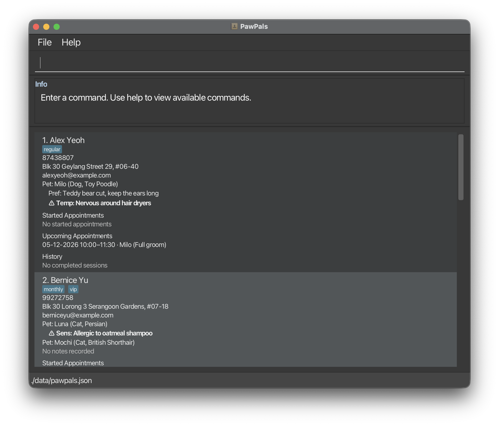

# PawPals

PawPals is a desktop app for independent mobile pet groomers to manage their clients, pets and appointments. It is optimised for typing commands, while still showing everything in a GUI.

## Key features

- Keep client contact records, with duplicate detection by name and phone.
- Record each client's pets (name, species, breed), with care notes on grooming preferences, sensitivities and temperament.
- Schedule appointments with an optional end time and the pets being groomed. Overlapping bookings are rejected across all clients.
- Cancel an appointment, or mark it done with session notes so it is kept in the client's grooming history.
- Find clients by name, phone or email, or find pet owners by pet name.

## Documentation

- [User Guide](docs/UserGuide.md)
- [Developer Guide](docs/DeveloperGuide.md)
- [About Us](docs/AboutUs.md)

## Acknowledgements

This project is based on the
[AddressBook-Level3](https://github.com/se-edu/addressbook-level3) project
created by the [SE-EDU initiative](https://se-education.org).

Libraries used include
[JavaFX](https://openjfx.io/),
[Jackson](https://github.com/FasterXML/jackson), and
[JUnit 5](https://github.com/junit-team/junit5).

## Licence

This project is distributed under the [MIT License](LICENSE).

## AI Acknowledgement

**Notable uses of AI in this project:**
* Claude (Anthropic) and Codex (OpenAI) were used to help write and refactor parts of the code and tests.
* The same tools were used to find bugs through scripted testing and to give preliminary reviews of pull requests.
* Claude was used to help draft parts of the User Guide, Developer Guide (including diagrams) and release notes.

All AI output was reviewed, tested and edited by team members before being committed.
