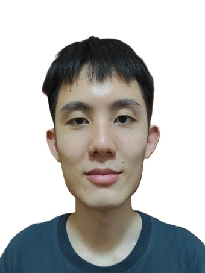
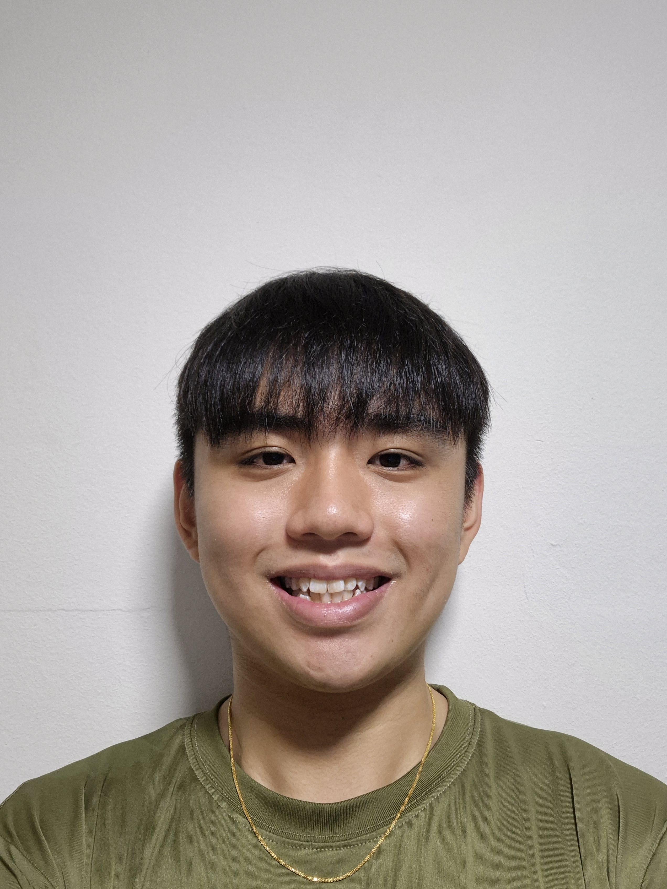
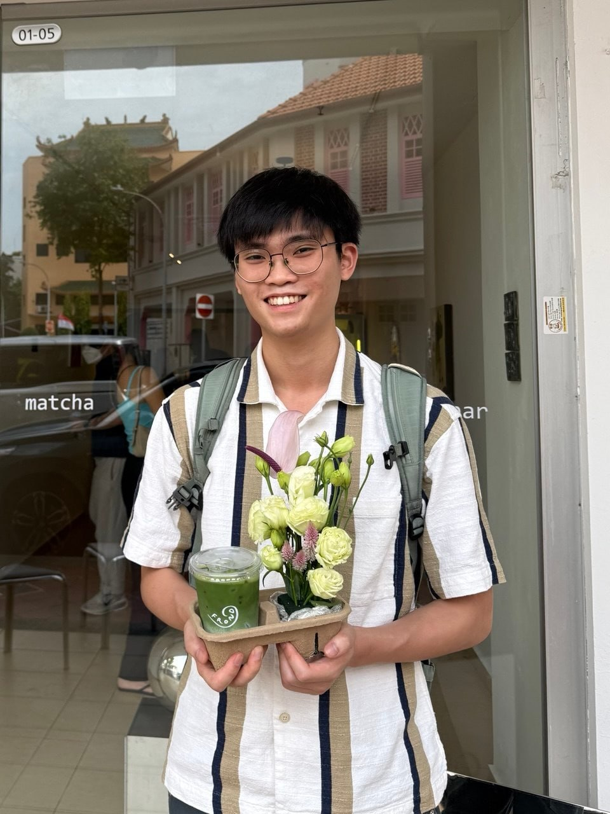

# About Us

We are five [National University of Singapore School of Computing](http://www.comp.nus.edu.sg) students developing PawPals, a desktop application that helps independent mobile pet groomers manage clients, pets, appointments, and grooming records.

You can find our source code and project updates on
[GitHub](https://github.com/AY2627S1-CS2103T-T14-4/tp).

## Project team

### Gabriel Lau Yi Jia

[[github](https://github.com/Frostwrath99)]

* Role: Developer
* Responsibilities: `addc`, `find`, `findp`, Duplicate checks, PawPals rename, UI mockup

### Tay Pengzhi Isaac

[[github](http://github.com/isaactay9856)]

* Role: Developer
* Responsibilities: `appt`, `cancel`, `done`, Overlap checks, Past appts, Session history, Markbind

### Yi Zhe Ser

[[github](https://github.com/isaacser8)]

* Role: Developer
* Responsibilities: `addp`, `editp`, `delp`, `delnote`, End times, Pet links, Sample data, Releases

### Marcus Goh

[[github](http://github.com/mgjk04)]

* Role: Developer
* Responsibilities: `editappt`, Client cards, History display, Command feedback, User stories

### Joshua Lee

[[github](http://github.com/currycurry11)]

* Role: Developer
* Responsibilities: `note`, Storage, Display, Corrupted-data recovery, Help window
