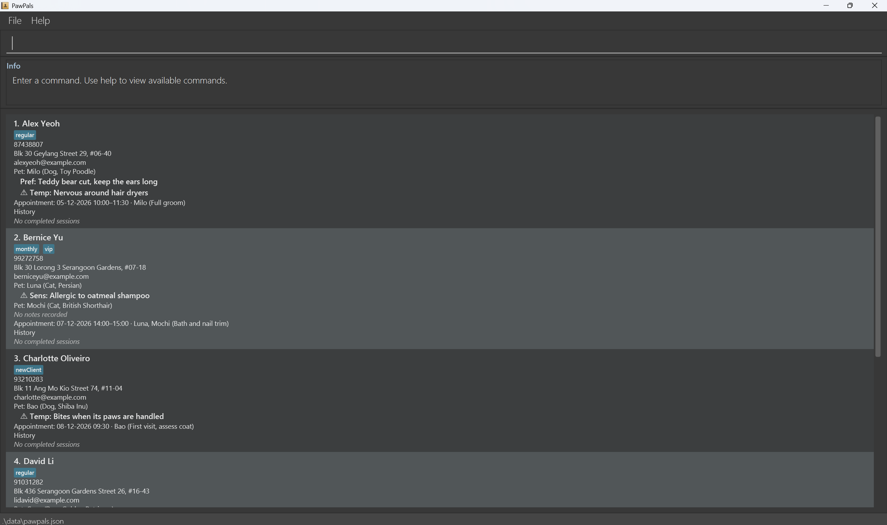
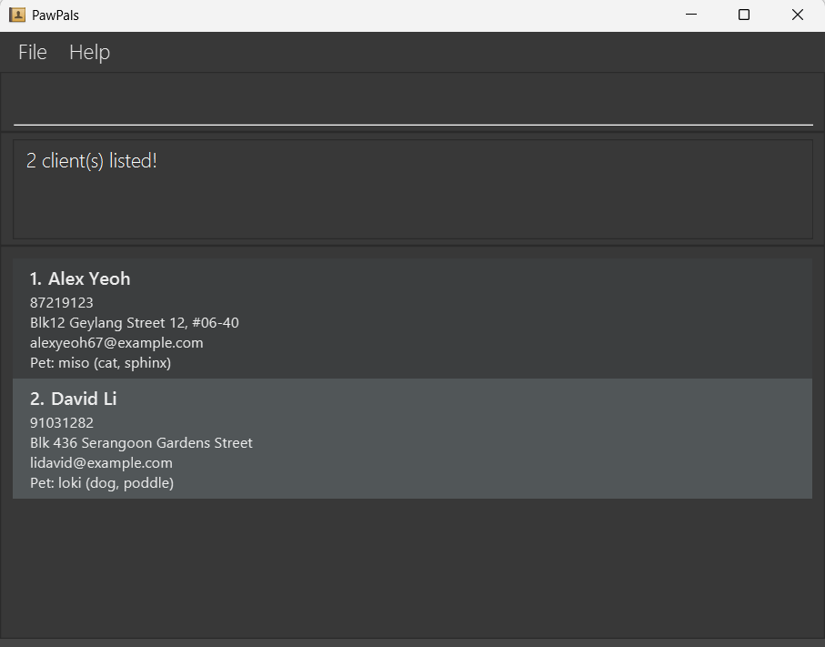

# PawPals User Guide

PawPals is a **desktop application for managing clients, pets, and appointments, optimized for use through a Command Line Interface (CLI)** while retaining the benefits of a Graphical User Interface (GUI). PawPals helps pet groomers manage their client records and schedules quickly.

<!-- * Table of Contents -->
<page-nav-print />

--------------------------------------------------------------------------------------------------------------------

## Quick start

1. Ensure that Java `25` or later is installed on your computer. 
   **Mac users:** Ensure you have the precise JDK version prescribed [here](https://se-education.org/guides/tutorials/javaInstallationMac.html).

1. Download the latest `pawpals.jar` file from the [PawPals releases page](https://github.com/AY2627S1-CS2103T-T14-4/tp/releases).

1. Copy the file to the folder you want to use as the _home folder_ for PawPals.

1. Open a terminal, `cd` to the folder containing the JAR file, and run `java -jar pawpals.jar`. 
   A GUI similar to the one below should appear in a few seconds. Note how the app contains some sample client data. 
   

1. Type a command in the command box and press Enter to execute it. For example, type **`help`** and press Enter to open the help window. 
   Some example commands you can try:

   * `list` : Lists all clients, their pets, and their appointments.

   * `addc n/John Doe p/98765432 e/johnd@example.com a/John street, block 123, #01-01` : Adds a client named `John Doe`.

   * `addp c/1 n/Milo s/Dog b/Poodle` : Adds a pet named `Milo` to the 1st client shown.

   * `appt c/1 d/12-12-2026 t/14:00` : Adds an appointment for the 1st client shown.

   * `delc 3` : Deletes the 3rd client shown in the current list.

   * `clear` : Deletes all clients, pets, and appointments.

   * `exit` : Exits the app.

1. Refer to the [Features](#features) section below for details of each command.

--------------------------------------------------------------------------------------------------------------------

## Features

<box type="info" seamless>

**Notes about the command format:** 

* Words in `UPPER_CASE` are the parameters to be supplied by the user. 
  For example, in `addc n/NAME`, replace `NAME` with a value such as `John Doe`.

* Items in square brackets are optional. 
  For example, `n/NAME [t/TAG]` can be used as `n/John Doe t/friend` or as `n/John Doe`.

* Items followed by `...` can appear zero or more times. 
  For example, `[t/TAG]... ` may be omitted, or written as `t/friend` or `t/friend t/family`.

* Tags (`t/TAG`) can be set using `addc` and `edit`. In `appt`, `t/` means **time**, not tag.

* Parameters can be in any order. 
  For example, if the command specifies `n/NAME p/PHONE_NUMBER`, `p/PHONE_NUMBER n/NAME` is also acceptable.

* Extraneous parameters for commands that take no parameters, such as `help`, `list`, `exit`, and `clear`, are ignored. 
  For example, `help 123` is interpreted as `help`.

* If you are using a PDF version of this document, be careful when copying and pasting commands that span multiple lines as space characters surrounding line-breaks may be omitted when copied over to the application.
</box>

### Viewing help: `help`

Shows a message explaining how to access the PawPals help page.

Format: `help`

### Adding a client: `addc`

Adds a new client and their contact details.

Format: `addc n/NAME p/PHONE e/EMAIL a/ADDRESS [t/TAG]...`

Example: `addc n/Alice Tan p/91234567 e/alicetan@example.com a/10 Dover Road t/regular t/vip`

* `NAME` must contain 1 to 60 characters, including at least one letter. Only letters, spaces, apostrophes, and hyphens are allowed. Leading and trailing spaces are removed, and repeated spaces are treated as one space.
* `PHONE` must contain 3 to 15 digits without spaces.
* `EMAIL` must contain 3 to 254 characters, exactly one `@` symbol with text before it, and a valid domain with at least one period. Leading and trailing spaces are removed; spaces within the email are not allowed.
* `ADDRESS` must contain between 1 and 200 characters. Leading and trailing spaces are removed.
* `TAG` is optional, may be added more than once, and must contain only letters and numbers.

Successful output: `New client added: Alice Tan`

Clients with the same name and phone number, ignoring name capitalisation and repeated spaces, are treated as duplicates.
If the command fails because of invalid input or a duplicate client, no client is added.

### Adding a pet: `addp`

Adds a pet belonging to an existing client.

Format: `addp c/CLIENT_INDEX n/NAME s/SPECIES b/BREED`

Example: `addp c/1 n/Milo s/Dog b/Poodle`

* `CLIENT_INDEX` must be a positive integer corresponding to an existing client in the displayed client list.
**Note:** `CLIENT_INDEX` refers to the index shown in the currently displayed client list. After using `find`, the index refers to the filtered search results, not the original full list.
For example, after running `find Alice`, if Alice appears at index 1, `addp c/1 n/Milo s/Dog b/Poodle` adds Milo to Alice.
* `NAME` must contain 1 to 40 letters, numbers, spaces, apostrophes, or hyphens. Leading and trailing spaces are removed, and repeated spaces are treated as one space.
* `SPECIES` must contain 1 to 40 letters, numbers, spaces, apostrophes, or hyphens. Leading and trailing spaces are removed, and repeated spaces are treated as one space.
* `BREED` must contain 1 to 60 letters, numbers, spaces, apostrophes, or hyphens. Leading and trailing spaces are removed.

Successful output: `New pet added: Milo`

After a successful command, the pet appears under the selected client's card in the format
`Pet: Milo (Dog, Poodle)`. The pet is saved as part of that client and remains available after restarting PawPals.

If the command fails, the corresponding validation message is displayed and no pet is added. A pet is a duplicate only when it has the same name as another pet belonging to the same client, ignoring name capitalisation and repeated spaces.

### Editing a pet: `editp`

Edits the name, species or breed of one of a client's pets. The pet's notes are kept.

Format: `editp c/CLIENT_INDEX pn/PET_NAME [n/NAME] [s/SPECIES] [b/BREED]`

Examples:
* `editp c/1 pn/Milo b/Toy Poodle` changes Milo's breed.
* `editp c/1 pn/Milo n/Max` renames Milo to Max.

* `CLIENT_INDEX` refers to the **currently displayed** client list, as in `addp`.
* `PET_NAME` is the pet's current name. It must match one of that client's pets, ignoring capitalisation and repeated spaces.
* At least one of `n/`, `s/` or `b/` must be given. `NAME`, `SPECIES` and `BREED` follow the same rules as in `addp`.
* Each prefix may appear only once, in any order.
* A pet cannot be renamed to the name of another of the same client's pets, ignoring capitalisation.
* Renaming a pet also renames it in the client's upcoming appointments. Completed sessions keep the old name,
  since they record what happened at the time.
* To change a pet's notes, use `note` and `delnote` instead.

Successful output: `Edited pet: Milo (Dog, Toy Poodle)`

If the command fails, the pet is not changed. Feedback includes:

| Problem | Feedback |
| --- | --- |
| Missing `c/` or `pn/`, or extra text before the first prefix | `Invalid command format!`, followed by the `editp` usage instructions. |
| None of `n/`, `s/` or `b/` given | `At least one field to edit must be provided.` |
| Repeated prefix, for example two `b/` values | `Multiple values specified for the following single-valued field(s): b/` |
| Zero, negative or non-integer index | `Index must be a positive integer.` |
| Positive index outside the displayed list | `The client index provided is invalid.` |
| No pet with that name | `This client has no pet named Rex.` |
| Invalid new name, species or breed | The same message as in `addp`. |
| New name already used by another of the client's pets | `This client already has a pet with the same name.` |

### Adding or updating a pet note: `note`

Records a note about one of a client's pets. Each pet can have one note of each type:

* `pref`: grooming preference, e.g. preferred cut
* `sens`: sensitivity, e.g. allergies or skin conditions
* `temp`: temperament, e.g. nervous around dryers

Sensitivity and temperament notes are safety information and are marked with ⚠ on the client card.

Format: `note c/CLIENT_INDEX pn/PET_NAME ty/TYPE nt/NOTE`

Example: `note c/1 pn/Milo ty/temp nt/Anxious around loud dryers`

* `CLIENT_INDEX` refers to the **currently displayed** client list, as in `addp`.
* `PET_NAME` must match one of that client's pets, ignoring capitalisation and repeated spaces.
* `TYPE` is `pref`, `sens` or `temp`, ignoring capitalisation.
* `NOTE` must contain 1 to 200 characters after leading and trailing spaces are removed.
* If the pet already has a note of that type, the new note replaces it. Other notes are kept.

Successful output: `Updated temperament note for Milo: Anxious around loud dryers`

### Deleting a pet note: `delnote`

Deletes one note from one of a client's pets. The pet's other notes are kept.

Format: `delnote c/CLIENT_INDEX pn/PET_NAME ty/TYPE`

Example: `delnote c/1 pn/Milo ty/temp`

* `CLIENT_INDEX`, `PET_NAME` and `TYPE` follow the same rules as `note`.
* All three prefixes are required, may appear in any order, and must each appear only once.

Successful output: `Deleted temperament note for Milo`

If the command fails, no note is changed. Feedback includes:

| Problem | Feedback |
| --- | --- |
| Missing prefix or extra text before the first prefix | `Invalid command format!`, followed by the `delnote` usage instructions. |
| Repeated prefix, for example two `ty/` values | `Multiple values specified for the following single-valued field(s): ty/` |
| Zero, negative or non-integer index | `Index must be a positive integer.` |
| Positive index outside the displayed list | `The client index provided is invalid.` |
| No pet with that name | `This client has no pet named Luna.` |
| Invalid type | `Note type must be pref, sens or temp.` |
| The pet has no note of that type | `Milo has no sensitivity note to delete.` |

### Deleting a client: `delc`

Removes an unwanted client record, all their pets, and all their appointments.

Format: `delc CLIENT_INDEX`

Example: `delc 2`

* `CLIENT_INDEX` must be a positive integer corresponding to an existing client in the displayed client list.

Successful output, if the selected client is Ben Lim: 
`Deleted client: Ben Lim; Phone: 91234567; Email: benlim@example.com; Address: 10 Dover Road; Tags: `

The message lists the deleted client's details so you can confirm the right client was removed.

The deleted client disappears from the client list, and the remaining clients are renumbered. If the command fails, no client, pet, or appointment is deleted.

### Adding an appointment: `appt`

Adds an appointment to an existing client. Use one or more `pn/` fields to identify the client's pets attending the appointment. You can also omit pet names, including for a client with no recorded pets.

Format: `appt c/CLIENT_INDEX d/DD-MM-YYYY t/HH:mm [et/HH:mm] [pn/PET_NAME]...`

Examples:

* `appt c/1 d/12-12-2026 t/12:34` — records a start time only.
* `appt c/1 d/12-12-2026 t/12:34 et/13:34` — records a start and end time.
* `appt c/1 d/12-12-2026 t/12:34 et/13:34 pn/Milo pn/Sir Fluffy` — links two pets belonging to the displayed client.

Rules:

* `c/`, `d/`, and `t/` are required; `et/` and `pn/` are optional. Fields may appear in any order. Each prefix except `pn/` may appear at most once, even if repeated values are identical. Repeat `pn/` for additional pets. Do not put extra text before the first prefix.
* `CLIENT_INDEX` must be a positive integer corresponding to an existing client in the **currently displayed** list. After `find`, index `1` refers to the first matching client, rather than the first client in the full list. Adding an appointment keeps the current filter.
* Each `pn/` must name a pet belonging to the selected client. Names are matched ignoring case, leading/trailing spaces and repeated spaces. For example, `pn/sir   FLUFFY` matches the recorded name `Sir Fluffy`. Unknown pets and pets belonging only to another client are rejected; add them to the selected client with `addp` first if appropriate.
* Repeated references to the same pet are ignored, including references with different casing or spacing. Linked pets are stored and reported using their recorded names, in first-reference order. An empty or invalid `pn/` is an error, even after a valid name. Pet names must be 1–40 characters after space normalization and contain only letters, numbers, spaces, apostrophes and hyphens.
* Omitting `pn/` creates an appointment without links to individual pets. It does not automatically select every pet belonging to the client.
* `DD-MM-YYYY` must be a valid calendar date with a year from `0001` to `9999`. Use two digits for the day and month, for example `09-01-2027`. Impossible dates such as `31-04-2027` and non-leap-year dates such as `29-02-2027` are rejected.
* `HH:mm` must be a valid time in 24-hour format, from `00:00` to `23:59`. Use two digits for both parts; seconds and AM/PM are not accepted.
* `t/` is the start time. If supplied, `et/` must also be a valid `HH:mm` time and must be strictly after the start time on the same date. Equal times and overnight appointments (for example, `t/23:00 et/01:00`) are rejected. Omitting `et/` records no end time; an empty `et/` is an error.
* The **combined date and time** must be strictly later than the computer's current date and time when the command executes, using its local time zone. Later today is valid. For example, at 10:30 today, today's `t/10:31` is valid but `t/10:30` is not.
* An appointment must not overlap **any active appointment across all clients**, including clients hidden by the current search filter. Overlaps are rejected for both the same client and different clients, regardless of appointment details or linked pets. The rejection identifies the conflicting client and booking slot.
* An appointment with an end time occupies its start time up to, but not including, its end time. Adjacent bookings such as `14:00–15:00` and `15:00–16:00` are allowed. Without an end time, a booking occupies its starting minute: `t/14:00` conflicts with a range containing 14:00 or another `t/14:00`, but permits a booking starting at 14:01. Appointments on different dates do not conflict.
* Completed-session history does not reserve booking slots. Cancelling an active appointment releases its slot; any new booking must still satisfy the future-date/time rule and avoid remaining active bookings.
* `t/` means time in `appt`. It means a tag in commands that accept tags. The `appt` command does not accept tags or appointment details.

Successful output, if the selected client's name is Ben Lim: `Added appointment: Ben Lim d/12-12-2026 t/12:34`

When an end time is supplied: `Added appointment: Ben Lim d/12-12-2026 t/12:34 et/13:34`

When pets are linked: `Added appointment: Ben Lim d/12-12-2026 t/12:34 et/13:34 pn/Milo pn/Sir Fluffy`

Linked pet names and optional end times are retained after restarting PawPals. Creating an appointment preserves the client's existing appointments, contact details, pets, pet notes and completed history.

The appointment's date and start time appear under the selected client's contact information. All appointment data, including an optional end time, is saved automatically and retained after restarting PawPals. End times are included in command feedback; the current client card shows the start time only. Stored nonblank details are also displayed when present. Appointments remain available after their scheduled time has passed. Editing the client's contact information preserves their appointments; deleting the client or clearing all records removes them.

If the command is rejected because of invalid input or an overlap, no data is changed. Validation feedback includes:

| Problem | Feedback |
| --- | --- |
| Missing required prefix or extra text before the first prefix | `Invalid command format!`, followed by the `appt` usage instructions. |
| Repeated prefix, for example two `et/` values | `Multiple values specified for the following single-valued field(s): et/` |
| Empty, zero, negative, non-integer, or too-large index | `Index must be a positive integer.` |
| Positive index outside the displayed list | `The client index provided is invalid.` |
| Invalid or empty date | `Appointment dates must be valid calendar dates in DD-MM-YYYY format, with a year from 0001 to 9999.` |
| Invalid or empty start/end time | `Appointment times must be valid times in 24-hour HH:mm format, from 00:00 to 23:59.` |
| End time equal to or before the start time | `End time must be after the start time.` |
| Empty or invalid pet name | `Pet names should be 1 to 40 characters long and contain only letters, numbers, spaces, apostrophes and hyphens.` |
| Pet not belonging to the selected client | `This client has no pet named Milo.` (with the requested pet name) |
| Past or current date/time | `Appointment date and time must be strictly in the future.` |
| Overlap with any client's active booking | `Appointment overlaps with Ben Lim's appointment: d/12-12-2026 t/12:34 et/13:34.` (with the conflicting client's name and slot; `et/` is omitted when no end time is recorded) |

The example date must still be in the future when you try it. Replace it with a future date if needed.

If PawPals reports a save error, the appointment may still appear during the current session but may not survive a restart. Resolve the file or folder access problem before relying on the appointment being saved.

### Cancelling an appointment: `cancel`

Removes one existing appointment from a client using its date and **start time**.
Both past and future appointments can be cancelled.

Format: `cancel c/CLIENT_INDEX d/DD-MM-YYYY t/HH:mm`

Example: `cancel c/1 d/12-12-2026 t/14:00`

* All three prefixes are required and may appear in any order. Each must appear exactly once,
  even if repeated values are identical. Do not put extra text before the first prefix.
* `CLIENT_INDEX` refers to the **currently displayed** client list. After `find`, index `1` refers to
  the first matching client. Cancellation keeps the current filter and does not delete the client.
* Date and time use the same strict formats as `appt`: a valid calendar date in `DD-MM-YYYY` format
  (years `0001` to `9999`) and a 24-hour time in `HH:mm` format (`00:00` to `23:59`).
  The appointment does not need to be in the future.
* Use the appointment's start time, even when it has an end time. An end time and pet names are not
  needed to identify it.

Successful output, if the selected client's name is Ben Lim:
`Cancelled appointment: Ben Lim d/12-12-2026 t/14:00`

Only that appointment is removed. The client's contact details, tags, pets, pet notes, other
appointments, and all other clients are preserved. The card updates automatically, and the
cancellation is saved so the appointment remains absent after restarting PawPals.

If validation fails, no data changes. Feedback includes:

| Problem | Feedback |
| --- | --- |
| Missing required prefix or extra text before the first prefix | `Invalid command format!`, followed by the `cancel` usage instructions. |
| Repeated prefix, for example two `t/` values | `Multiple values specified for the following single-valued field(s): t/` |
| Empty, zero, negative, non-integer, or too-large index | `Index must be a positive integer.` |
| Positive index outside the displayed list | `The client index provided is invalid.` |
| Invalid or empty date | `Appointment dates must be valid calendar dates in DD-MM-YYYY format, with a year from 0001 to 9999.` |
| Invalid or empty time | `Appointment times must be valid times in 24-hour HH:mm format, from 00:00 to 23:59.` |
| No matching appointment, including one already cancelled | `Ben Lim has no appointment at 12-12-2026 14:00.` (with the selected client's name and requested slot) |

If saving fails, the appointment may be removed in the current session but remain in the saved file.
Resolve the reported file or folder access problem before relying on the cancellation being saved.

### Completing an appointment: `done`

Marks one existing appointment as completed and records grooming-session notes. The active booking is
removed and an immutable copy is retained in the client's completed-session history.

Format: `done c/CLIENT_INDEX d/DD-MM-YYYY t/HH:mm nt/NOTES`

Example: `done c/1 d/12-12-2026 t/14:00 nt/Teddy cut, short ears`

* All four prefixes are required and may appear in any order. Each must appear exactly once, even if
  repeated values are identical. Do not put extra text before the first prefix.
* `CLIENT_INDEX` refers to the **currently displayed** client list. After `find`, index `1` means the
  first matching client. Completion preserves the filter and all other clients.
* Use the appointment's date and **start time**, with the same `DD-MM-YYYY` and `HH:mm` formats as `appt`.
  No end time or pet names are needed to identify the booking.
* The appointment must have started according to the computer's current local date and time. It can
  be completed exactly at its start, before its planned end, or later. Future appointments are rejected.
* `NOTES` must contain 1–200 characters after trimming leading and trailing whitespace. Internal spaces
  are retained. Notes describe this visit and do not replace booking details or standing pet notes.
* A visit covering several pets creates one history record containing its recorded pet names. An
  appointment without linked pets remains a client-only session; current pets are not inferred.
* Repeating `done` for a slot with no remaining active booking is rejected without adding another record
  or changing existing notes. If an active booking matches an older history entry, the active booking
  is selected first.

Successful output for a client-only booking with no end time:
`Completed session: Ben Lim d/12-12-2026 t/14:00 nt/Teddy cut, short ears`

When the booking has an end time and linked pets, these are also reported:
`Completed session: Ben Lim d/12-12-2026 t/14:00 et/15:30 pn/Milo pn/Luna nt/Teddy cut, short ears`

The active appointment disappears from the client card. Its date, start time, optional end time,
booking details and linked pet names are retained in history with the session notes and logging time.
The logging time records when `done` was executed, rather than claiming an actual grooming finish time.
Completion is saved automatically and retained after restarting PawPals. Later pet rename/deletion
does not change completed records. Other appointments, contact details, tags, pets, pet notes and
previous history are preserved. Deleting the client removes its history; `clear` removes all history.

Completed history never reserves a slot. Completing early releases the remaining planned interval for
another booking. A new booking must still start strictly in the future and avoid all remaining active
appointments; completing a visit does not permit rebooking a past or current start time.

If validation fails, no data changes. Feedback includes:

| Problem | Feedback |
| --- | --- |
| Missing required prefix or extra text before the first prefix | `Invalid command format!`, followed by the `done` usage instructions. |
| Repeated prefix, for example two `nt/` values | `Multiple values specified for the following single-valued field(s): nt/` |
| Invalid index, date or start time | The corresponding index, date or time validation message used by `appt`. |
| Empty notes or more than 200 characters after trimming | `Session notes should be between 1 and 200 characters long.` |
| Appointment has not started | `An appointment cannot be completed before its scheduled start time.` |
| No active appointment at the requested slot | `Ben Lim has no active appointment at 12-12-2026 14:00.` |
| Already completed slot with no active booking | `Ben Lim already has a completed session at 12-12-2026 14:00.` |

The example requires a matching active appointment that has already started. Replace the date and
time with an existing booking when trying the command.

If saving fails, completion may exist in memory while the saved file still contains the active booking.
Resolve the reported file or folder access problem before relying on the completion being saved.

### Listing all clients: `list`

Shows an overview of all clients, their appointments, and their pets.

Format: `list`

Example: `list`

Each client entry displays the client's phone number, address, email, pets, and appointments. Each pet is shown
under its client with its name, species, and breed. Clients without pets continue to display without a pet entry.

### Editing a client: `edit`

Edits an existing client in PawPals.

Format: `edit INDEX [n/NAME] [p/PHONE] [e/EMAIL] [a/ADDRESS] [t/TAG]... `

* Edits the client at the specified `INDEX`. The index refers to the index number shown in the displayed client list. The index **must be a positive integer** 1, 2, 3, ...
* At least one of the optional fields must be provided.
* Existing values will be updated to the input values.
* When editing tags, all of the client's existing tags are removed; adding tags is not cumulative.
* To remove all of a client's tags, enter `t/` without a tag after it.

Examples:
*  `edit 1 p/91234567 e/johndoe@example.com` Edits the phone number and email address of the 1st client to be `91234567` and `johndoe@example.com` respectively.
*  `edit 2 n/Betsy Crower t/` Edits the name of the 2nd client to be `Betsy Crower` and clears all existing tags.

### Locating clients by name or contact: `find`

Finds all clients whose names, phone numbers, or emails match any of the given keywords.

Format: `find KEYWORD [MORE_KEYWORDS]`

* The search is case-insensitive; for example, `hans` matches `Hans`.
* Keyword order does not matter; for example, `Hans Bo` matches `Bo Hans`.
* The search considers only names.
* Only full words match; for example, `Han` does not match `Hans`.
* Clients matching at least one keyword are returned (an `OR` search); for example, `Hans Bo` returns `Hans Gruber` and `Bo Yang`.

Examples:
* `find John` returns `john` and `John Doe`
* `find 91234567` returns all clients with that exact phone number
* `find alice@example.com` returns all clients with that exact email
* `find alex david` returns `Alex Yeoh`, `David Li` 
  

### Locating pet owners by pet name: `findp`

Finds all clients who own pets whose names match any of the given keywords.

Format: `findp KEYWORD [MORE_KEYWORDS]`

Pet-name matching is case-insensitive and requires a full-name match. Multiple keywords use OR search.
The displayed client cards remain unchanged, so client indexes can be used with other commands.

Examples:
* `findp Milo` returns the owners of pets named `Milo`
* `findp Milo Luna` returns the owners of pets named `Milo` or `Luna`

### Clearing all entries: `clear`

Clears all clients, pets, and appointments from PawPals.

Format: `clear`

### Exiting the program: `exit`

Exits the program.

Format: `exit`

### Saving the data

PawPals automatically saves client, pet, and appointment data after every command. Pets are saved under their
owning client and remain available after restarting PawPals. You do not need to save manually.

### Editing the data file

PawPals data is saved automatically as a JSON file `[JAR file location]/data/pawpals.json`. Advanced users are welcome to update data directly by editing that data file.

<box type="warning" seamless>

**Caution:**
If your changes make the data file invalid, PawPals starts with an empty client list at the next run. The invalid file remains on disk until you run a command (PawPals saves after every command). Still, we recommend backing up the file before editing it. 
Furthermore, certain edits can cause PawPals to behave in unexpected ways (e.g., if a value entered is outside of the acceptable range). Therefore, edit the data file only if you are confident that you can update it correctly.
</box>

### Archiving data files `[coming in v2.0]`

_Details coming soon ..._

--------------------------------------------------------------------------------------------------------------------

## FAQ

**Q**: How do I transfer my data to another computer? 
**A**: Install PawPals on the other computer and overwrite the data file it creates with the data file from your previous PawPals home folder.

--------------------------------------------------------------------------------------------------------------------

## Known issues

1. **When using multiple screens**, if you move the application to a secondary screen, and later switch to using only the primary screen, the GUI will open off-screen. The remedy is to delete the `preferences.json` file created by the application before running the application again.
2. **If you minimize the Help Window** and then run the `help` command (or use the `Help` menu, or the keyboard shortcut `F1`) again, the original Help Window will remain minimized, and no new Help Window will appear. The remedy is to manually restore the minimized Help Window.

--------------------------------------------------------------------------------------------------------------------

## Command summary

Action     | Format, Examples
-----------|----------------------------------------------------------------------------------------------------------------------------------------------------------------------
**Add client** | `addc n/NAME p/PHONE e/EMAIL a/ADDRESS [t/TAG]...`  e.g., `addc n/James Ho p/22224444 e/jamesho@example.com a/123, Clementi Rd, 1234665`
**Add pet** | `addp c/CLIENT_INDEX n/NAME s/SPECIES b/BREED`  e.g., `addp c/1 n/Milo s/Dog b/Poodle`
**Edit pet** | `editp c/CLIENT_INDEX pn/PET_NAME [n/NAME] [s/SPECIES] [b/BREED]`  e.g., `editp c/1 pn/Milo b/Toy Poodle`
**Add/update pet note** | `note c/CLIENT_INDEX pn/PET_NAME ty/TYPE nt/NOTE`  e.g., `note c/1 pn/Milo ty/temp nt/Anxious around loud dryers`
**Delete pet note** | `delnote c/CLIENT_INDEX pn/PET_NAME ty/TYPE`  e.g., `delnote c/1 pn/Milo ty/temp`
**Clear**  | `clear`
**Delete client** | `delc CLIENT_INDEX`  e.g., `delc 3`
**Add appointment** | `appt c/CLIENT_INDEX d/DD-MM-YYYY t/HH:mm [et/HH:mm] [pn/PET_NAME]...`   e.g., `appt c/1 d/12-12-2026 t/12:34 et/13:34 pn/Milo pn/Luna`
**Cancel appointment** | `cancel c/CLIENT_INDEX d/DD-MM-YYYY t/HH:mm`   e.g., `cancel c/1 d/12-12-2026 t/14:00`
**Complete appointment** | `done c/CLIENT_INDEX d/DD-MM-YYYY t/HH:mm nt/NOTES`   e.g., `done c/1 d/12-12-2026 t/14:00 nt/Teddy cut, short ears`
**Edit**   | `edit INDEX [n/NAME] [p/PHONE_NUMBER] [e/EMAIL] [a/ADDRESS] [t/TAG]... `  e.g.,`edit 2 n/James Lee e/jameslee@example.com`
**Exit**   | `exit`
**Find**   | `find KEYWORD [MORE_KEYWORDS]`  e.g., `find James Jake`
**List**   | `list`
**Help**   | `help`
